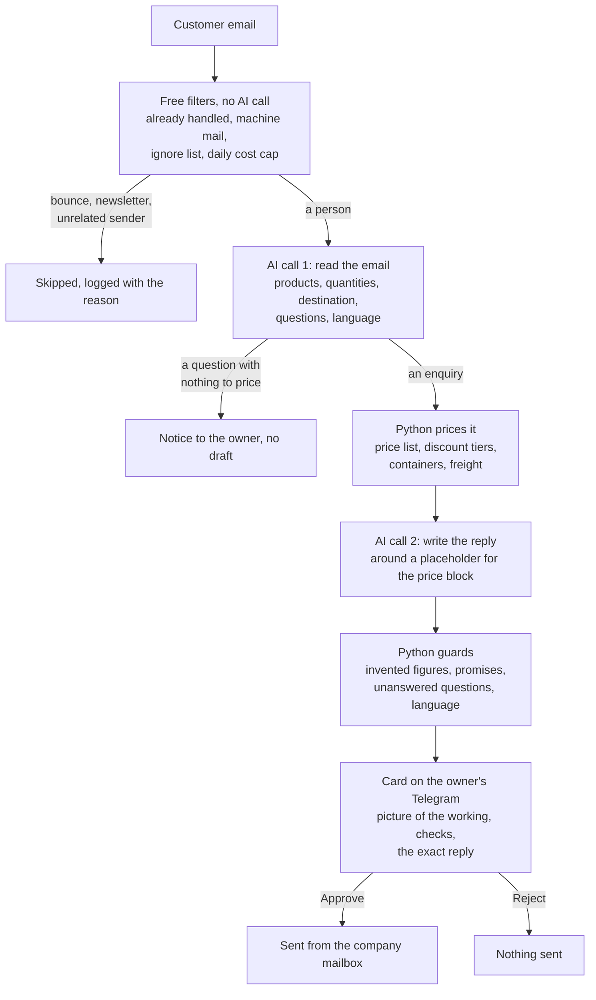
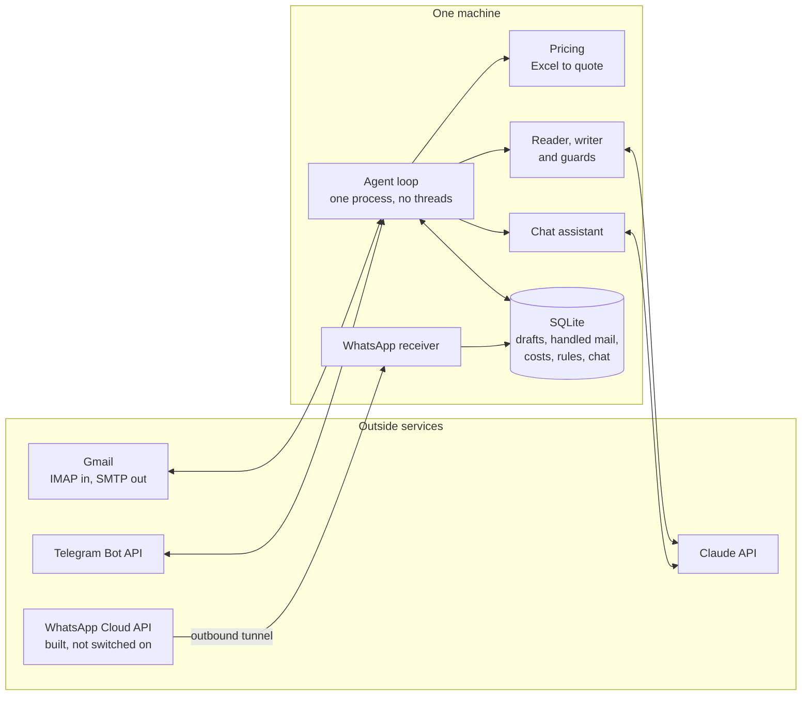

# Sales Agent

An email quoting agent for a company that exports insulated sandwich panels. It reads a price enquiry, works out the quote in Python from the company's price list, has Claude write the reply around the numbers, and sends the owner a card on Telegram. Nothing reaches a customer until the owner taps **Approve**.

**The source code is private (client project). This repository only describes the work.**

Freelance project, October 2026. Python, Claude API, Telegram, SQLite.

## The problem

Most of the sales inbox was the same email: "how much for 40 PIR panels, 100 mm, delivered to Hamburg?" Each one meant opening the price list, working out how many containers the order fills, and writing a polite reply in English or Russian.

The agent does that part. The owner still reads every reply and decides whether it goes out.

## How an enquiry is handled

1. **Filters.** Bounces, auto-replies, newsletters, the inbox's own mail, senders on an ignore list and anyone over the per-sender limit are dropped before any paid call. A domain that sends three unrelated emails in 30 days is added to the ignore list by itself.
2. **Reading.** The first call turns the email into a fixed schema (structured output): what was asked for, how many, where to, what else the customer asked, and in which language. The email is wrapped and marked as untrusted data.
3. **Pricing.** Plain Python with exact decimals: match each product and destination in the Excel price list, apply the discount tier, count containers (rounded up), add freight, check the weight. If a product is ambiguous or a destination is unknown, it does not guess. It drafts a clarification that lists the options instead.
4. **Writing.** The second call writes the reply with a `[[QUOTATION]]` placeholder where the prices go. Python pastes in its own price block, so the model never types a price. The reply is in the customer's language when it is English or Russian, and in English otherwise.
5. **Guards.** Python checks the draft. A money figure or a time period that Python did not supply blocks the Approve button. Promises, unanswered questions and a wrong reply language are listed on the card for the owner to check.
6. **Approval.** The owner gets two Telegram messages: a picture of the calculation as a table, then the card with the email, the checks and the exact reply. Approve sends it. Reject drops it. Replying under the card with new text replaces the draft. For a clarification there are one-tap buttons such as "Ask quantity" and "Ask destination".

## Architecture

The agent runs as one Python loop: it long-polls Telegram and checks the inbox once a minute. Telegram long polling means nothing on the machine has to accept connections from the internet. The WhatsApp receiver is the one exception, and it is reached only through an outbound tunnel and checks Meta's signature on every request.

## Design decisions

- **The price is computed in Python, never by the model.** The model only reads the email and writes the prose. A figure the model invents anyway blocks the card.
- **One way to send.** Only the Approve button sends, and it is bound to one draft. Approval is claimed once in the database, so a double tap or a restart cannot send twice.
- **The recipient is fixed when the draft is created**, from the email's From header, and checked again on send. Nothing a customer writes can change who gets the reply.
- **One SQLite file.** Each email is claimed in the same transaction that stores its draft. If the agent crashes halfway, it picks up where it stopped instead of drafting or sending twice.
- **Refuse rather than guess.** An ambiguous product or an unknown port gets a clarification, not a price.
- **Only the owner is listened to.** Telegram messages from anyone but the owner's user id are ignored.
- **Every AI call is priced and stored.** The morning summary says what yesterday cost. A daily cap (default $2) and a per-sender limit (8 enquiries a day) stop a flooded inbox from running up the bill. Over the cap, email waits for the night batch.
- **Cheaper where it does not matter.** Enquiries that arrive at night go through the Batch API at half price. Prompts are cached. The reading call runs at low effort.
- **The price list follows the factory's online sheet.** The agent checks it every hour, imports it when it changed, validates the import before swapping it in, and tells the owner what moved. A broken update never replaces a good list.
- **Every draft keeps the text the AI wrote**, so the agent can report how many replies went out unedited and how much the edited ones changed.
- **No agent framework.** Plain Python and one loop, so the client or the next developer can read it when something breaks.

## The owner's side

- **Chat assistant.** In the same Telegram chat the owner can ask "what is waiting?", "what if they take 60?", "make it shorter" or "add that production takes 15 working days". It rewrites and re-prices drafts, remembers standing rules, and sends a morning summary. It cannot approve, reject or send.
- **Repeat customers.** A card from someone quoted before says so, and "same as last time" reuses the previous product and destination.
- **Watchdog.** The loop writes a heartbeat; a timer sends a Telegram alarm if it stops.

## Testing and evaluation

- The free tests replace every outside service (Claude, Gmail, Telegram, Meta) with a fake. CI runs lint and the tests on every push.
- **Extraction eval.** 26 test emails written for this business (English and Russian enquiries, follow-ups, questions and unrelated mail) with the expected fields. CI replays the recorded run. A change to the prompt, model, effort or schema fails the build until a new run is recorded.
- **Rehearsal.** Before touching a real inbox, the whole loop can run on a folder of sample emails against the real price list. Nothing is sent.

## Results

These are the measured results. Each one ran on test emails, not on the client's mail.

| What was measured | Result |
|---|---|
| Extraction eval, 26 written emails, every field correct (Claude Sonnet 5.5, low effort) | **26/26**, about 3 cents for the whole run |
| Paid drafting test, 10 real API calls (English, Russian, German, a prompt-injection email) | **26/26 checks**, $0.063 |
| Free checks after the first code review (pricing, database, guards, Telegram) | **1,513**, all passing, up from 73 before the review |
| A free open model (Nemotron 3 Super) tried for reading emails | 2 of 16 correct, so customer-facing calls stay on Claude |

There are no figures from daily use on this page yet. That includes the share of replies sent unedited, the cost per email and the time to a reply. The agent records them.

## Status

- **Email:** built and run against a real Gmail inbox and Telegram in test mode, where Approve sends only to a test address.
- **WhatsApp:** built and tested end to end against a fake Meta API. The live setup has not been switched on.

## Limitations

- The guards are pattern checks, not a proof. They miss a period with no number in it ("a few weeks") and small amounts written in words. That is why a person approves every reply.
- Replies are in English or Russian only. A new language needs its own guard words and tests.
- Refusing to guess means vague enquiries get a clarification instead of a price.
- There is no follow-up yet on a quote that gets no answer, and no PDF proforma.
- Quotes say nothing about validity, payment terms or delivery time until the owner writes those facts down for the agent.
- The extraction eval is 26 written emails, not real client mail.
- One machine, one owner, one SQLite file. It is not built for several companies.

## Tech stack

- **Agent:** Python 3.12, Claude API (Sonnet 5.5 with structured outputs, prompt caching and the Batch API), Pydantic, openpyxl, IMAP and SMTP, Telegram Bot API (long polling), Pillow, SQLite
- **Around it:** an MCP server for the quoting tools, OpenTelemetry tracing, Docker Compose, systemd timers
- **Quality:** pytest, ruff, GitHub Actions

About 15,500 lines of Python and 13,700 lines of tests.
